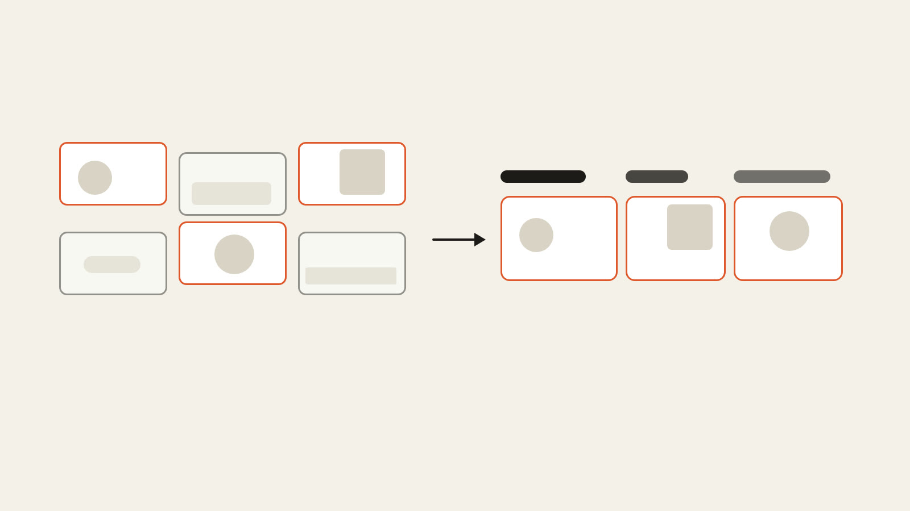

# footage-cut

An [OpenFilm](https://github.com/openfilm/openfilm) skill: a film cut from your own footage. Give it a folder of
clips and either a narration (a voice-over, or a script it voices) or nothing but the clips, and each shot ends up on
screen because of what is being said at that moment: a line of your narration, or the people in the footage.

| | | |
| --- | --- | --- |
|  | [Cut my footage](skills/footage-cut) | Your own clips cut into a film, each shot chosen for what is being said, to your narration or the story in the footage. |

An agent can't watch a folder of video. It can read pictures and transcripts, so the skill's one script turns the
folder into both:

```sh
node skills/footage-cut/scripts/footage.mjs <folder>
```

It writes `footage-log/` in the folder: `footage.json`, `footage.html`, and one picture per shot with its first,
middle and last frame. Each clip gets a letter in file-name order and each shot a number (`A1`, `A2`, `B1`), so a
shot list can name them. Shots come from ffmpeg's scene detection (`--threshold`, 0.3 by default; lower finds more
cuts), and none is shorter than 0.6 s unless the whole clip is. What is said in a shot comes from the WebVTT beside its clip, which
`npx openfilm get asr --src <clip>` writes; clips with sound and no transcript yet are listed. Shots whose middle frames
look alike, in any clip, are grouped (a 64-bit difference hash, 6 bits apart or fewer), so the same moment filmed
twice isn't used twice.

What the brief asks of the agent:

- only your footage, trimmed, never re-encoded; nothing generated or downloaded unless you ask;
- a shot list (line, shot, what it shows) handed over with the film; a shot used once, look-alikes counted as one;
- no shaky, blurred, dark or photobombed shots unless one is the only shot of its moment, and then it says so;
- cuts on the narration's pauses, on the beat, and inside speech in the footage only in its pauses, within two
  frames;
- your narration as you recorded or wrote it; nobody in the footage made to say what they didn't;
- the minutes of transcription said before a paid service runs, and at the end, the lines that had no good shot
  and what to film for them.

## Use it

- **In OpenFilm**: open Skills, add one from a link, and paste `https://github.com/WEBGRS/openfilm-footage-cut`.
- **In your own agent** (Claude Code, Codex and others): `npx skills add WEBGRS/openfilm-footage-cut`.

It needs Node 22 or later and ffmpeg on the PATH (OpenFilm needs ffmpeg too). For clips with speech, a transcription
service connected in OpenFilm (Settings → Providers).

## Develop

```sh
npm test            # makes three short clips with ffmpeg and logs them (about a minute)
npm run check       # the skill folder against OpenFilm's skill rules
```

## 中文说明

OpenFilm 技能：用你自己拍的素材剪成片。给它一个素材文件夹，再给一段解说（录好的配音，或者让它配音的文案），或者什么都不给只有素材；每个镜头出现在画面上，都是因为那一刻在说的话：你的解说，或者素材里的人说的话。

智能体看不了一整个文件夹的视频，但能看图、能读文字，所以这个技能唯一的脚本把文件夹变成这两样：`node skills/footage-cut/scripts/footage.mjs <文件夹>` 在文件夹里写出 `footage-log/`：`footage.json`、`footage.html`，每个镜头一张图（首帧、中间帧、尾帧）。每段素材按文件名排序编一个字母，每个镜头编一个号（`A1`、`A2`、`B1`），镜头表就用这些编号。镜头由 ffmpeg 的场景检测切出（`--threshold` 默认 0.3，调低会切得更细），除非整段素材本身更短，否则每个镜头至少 0.6 秒。每个镜头里说了什么，来自素材旁边的 WebVTT，用 `npx openfilm get asr --src <素材>` 生成；有声音但还没转写的素材会被列出来。各段素材里中间帧长得一样的镜头会归成一组，同一个画面拍了两遍不会用两次。

需求书对智能体的要求：只用你的素材，只裁剪不重新编码，没你同意不生成、不下载；交片时附镜头表（哪句话、哪个镜头、拍的是什么），一个镜头只用一次，长得一样的算同一个；不用晃的、虚的、太暗的、有路人乱入的镜头，除非那是那一刻唯一的镜头，并且要说明；在解说的停顿和音乐的节拍上剪，素材里有人说话就只在停顿处剪，误差两帧以内；你的解说保持原样，不让素材里的人说他们没说过的话；用付费服务转写前先说要转写多少分钟；最后告诉你哪些句子没有合适的镜头、还该补拍什么。

**安装**：在 OpenFilm 的技能页点「添加 skill」，粘贴链接 `https://github.com/WEBGRS/openfilm-footage-cut`；用自己的智能体就运行 `npx skills add WEBGRS/openfilm-footage-cut`。需要 Node 22 以上和 PATH 里的 ffmpeg；素材里有人说话的，还要在 OpenFilm 的设置（左上角的 OpenFilm 标志）→ 服务商里连好一个语音转写服务。
